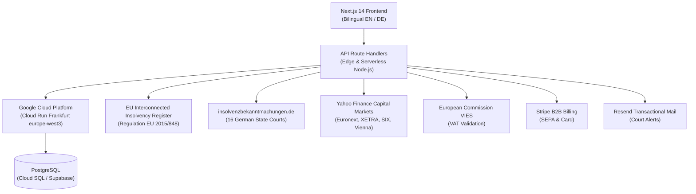

# 🏛️ Solven (Insolvenz-Wächter)
### Pan-European Corporate Intelligence, Solvency Sentinel & Insolvency Early-Warning System

[](https://nextjs.org/)
[](https://www.typescriptlang.org/)
[](https://tailwindcss.com/)
[](https://www.docker.com/)
[](https://cloud.google.com/run)
[](https://gdpr.eu/)

> **Solven** (formerly *Insolvenz-Wächter*) is an enterprise B2B corporate solvency intelligence platform. It provides automated daily insolvency monitoring, real-time risk dossiers, and cross-border early warnings across **Germany (DE), Austria (AT), Switzerland (CH), and all 27 European Union member states**.

---

## 🌟 Key Capabilities

### 1. 🇪🇺 Pan-European Registry & Jurisdiction Architecture
- **Mandatory Country Selector**: Users select a target jurisdiction before searching, routing queries to the appropriate national register authority.
- **National Registry Integrations**:
  - 🇩🇪 **Germany**: *Handelsregister* (Amtsgerichte, HRB/HRA)
  - 🇦🇹 **Austria**: *Firmenbuch* (Landesgerichte / Handelsgericht Wien, FN)
  - 🇨🇭 **Switzerland**: *Zefix* (Handelsregisterämter der Kantone, CHE)
  - 🇳🇱 **Netherlands**: *Kamer van Koophandel* (KVK)
  - 🇫🇷 **France**: *Infogreffe / Registre du Commerce et des Sociétés* (RCS)
  - 🇮🇹 **Italy**: *Registro delle Imprese* (Camera di Commercio, REA)
  - 🇪🇸 **Spain**: *Registro Mercantil Central* (Tomo/Folio/Hoja)
  - 🇵🇱 **Poland**: *Krajowy Rejestr Sądowy* (KRS)
  - 🇧🇪 **Belgium**, 🇸🇪 **Sweden**, 🇩🇰 **Denmark**, 🇱🇺 **Luxembourg**, 🇮🇪 **Ireland**, and all EU-27 states.

### 2. 📑 4-Tab Executive Risk Audit & Due Diligence Dossiers
- **Tab 1: Register & Solvency Score**: Verified legal form, registered nominal capital, court jurisdiction, and dynamic risk scoring (0–100).
- **Tab 2: Media & Crisis Radar**: Continuous scanning of commercial publications, financial gazettes, and restructuring rumors with positive sentiment scores.
- **Tab 3: Capital Markets, Financials & VAT**:
  - Live stock ticker & market cap quotes via European exchanges (XETRA, Euronext Paris/Amsterdam, SIX Swiss Exchange, Wiener Börse, Borsa Italiana, Bolsa de Madrid).
  - Estimated equity ratios for private limited liability entities (GmbH, B.V., SAS, S.r.l., S.L.).
  - Automated EU VIES VAT ID verification with protocol proof.
- **Tab 4: Judicial Notices & Digital Infrastructure Sentinel**:
  - Cross-references national insolvency gazettes (*insolvenzbekanntmachungen.de*, *Österreichische Ediktsdatei*, *SHAB*, *CIR*, and the *EU Interconnected Insolvency Register - IRI* under EU Regulation 2015/848).
  - DNS resolution latency, TLS 1.3 / 256-bit certificate validation, and MX email routing status.
- **1-Click Audit PDF Export**: Institutional print stylesheet generating clean due diligence PDF dossiers.

### 3. ⏰ Automated 07:00 AM Court Sentinel
- Daily background engine grouping watched entities by register authority to eliminate duplicate queries.
- Instant alert dispatch via **Resend** when a monitored entity enters preliminary insolvency proceedings, debtor disclosures, or liquidation.

### 4. 💳 B2B Subscription Engine (Stripe)
- Self-service billing supporting **Credit Card** and **SEPA Lastschrift**.
- Automatic EU Reverse Charge and German 19% MwSt handling.
- **Free**: 3 companies monitored (with demo session persistence).
- **Pro (€29/mo)**: Up to 25 companies, daily alerts, full risk dossiers.
- **Business (€79/mo)**: Up to 100 companies with team access.

### 5. 🛡️ DSGVO / GDPR & Frankfurt Data Residency
- Built specifically for compliance in the DACH & EU region:
  - Frankfurt am Main (`europe-west3`) data residency on Google Cloud Platform.
  - Art. 30 DSGVO compliant audit logging (`audit_logs` table).
  - Zero-tracking privacy architecture with persistent local consent banner.
  - Complete German legal suite: Impressum (§ 5 DDG), Datenschutzerklärung, and AGB.

---

## 🏗️ System Architecture



---

## 📁 Repository Structure

```
.
├── docs/                                  # Strategic plans, master tracker & architecture deep-dives
│   ├── production_enterprise_tracker.md   # Live 29-task enterprise workstream tracker
│   ├── mvp_launch_plan.md                 # 30-day MVP traction and go-to-market plan
│   └── insolvenz_waechter_agent_plan.md   # Architectural design specifications
├── web/                                   # Next.js 14 Web Application
│   ├── Dockerfile                         # Production multi-stage Alpine container (<120MB)
│   ├── cloudrun-service.yaml              # Cloud Run specification (Frankfurt europe-west3)
│   ├── deploy-gcp.sh                      # Automated GCP deployment script
│   ├── supabase/
│   │   └── migrations/                    # PostgreSQL schemas & migrations (01, 02, 03 Pan-EU)
│   ├── src/
│   │   ├── app/                           # App Router routes (/, /dashboard, /login, /impressum, etc.)
│   │   │   ├── api/                       # API proxies (/search, /stock, /stripe, /cron/sentinel)
│   │   │   ├── dashboard/page.tsx         # Watchlist command center & portfolio metrics
│   │   │   └── layout.tsx                 # Root layout & providers
│   │   ├── components/                    # UI Components (CompanyDossierModal, SearchModal, etc.)
│   │   └── lib/                           # Core utilities (countries.ts, stripe.ts, i18n.tsx, etc.)
│   └── package.json
└── README.md
```

---

## 🚀 Quickstart & Local Development

### Prerequisites
- **Node.js**: v18.17+ or v20+
- **npm** or **pnpm**

### Setup Instructions

1. **Clone the repository**:
   ```bash
   git clone https://github.com/sukratkaushik/solven.git
   cd solven/web
   ```

2. **Install dependencies**:
   ```bash
   npm install
   ```

3. **Configure Environment Variables**:
   ```bash
   cp .env.example .env.local
   ```
   Fill in your Supabase credentials, Stripe keys, and Resend API key.

4. **Start the development server**:
   ```bash
   npm run dev -- -p 3002
   ```

5. **Open the application**:
   - Landing Page: [http://localhost:3002](http://localhost:3002)
   - Demo Dashboard: [http://localhost:3002/dashboard?demo=true](http://localhost:3002/dashboard?demo=true)

---

## 🐳 Production Deployment (Google Cloud Platform)

The application is containerized with a hardened multi-stage Docker build running as an unprivileged `nextjs` user.

### Deploy to Google Cloud Run (Frankfurt `europe-west3`):

```bash
cd web
export PROJECT_ID="your-gcp-project-id"
export REGION="europe-west3"

chmod +x deploy-gcp.sh
./deploy-gcp.sh
```

---

## ⚖️ Legal & Compliance

- **German Digital Services Act**: Compliant imprint according to § 5 DDG.
- **European Insolvency Regulation**: Built in accordance with Regulation (EU) 2015/848 on insolvency proceedings.
- **Privacy & Data Protection**: Zero tracking, self-hosted session handling, and DSGVO Art. 30 processing records.

---

## 📄 License
Proprietary — All rights reserved.
