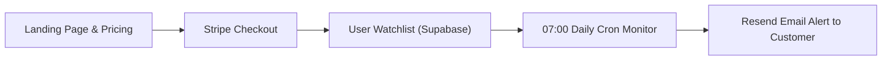
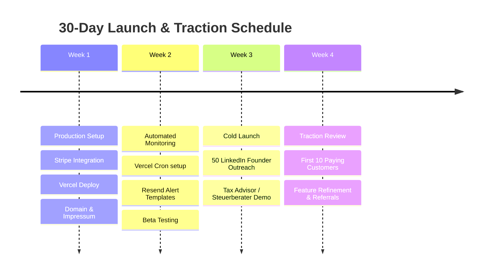

# 🚀 Insolvenz-Wächter: Lean MVP Launch & Traction Plan

> **Goal**: Launch a fully functioning production MVP within **14–21 days** with **minimal out-of-pocket API spend (< €30/month)** to validate market demand and acquire the first **10–20 paying B2B customers**.

---

## 1. Minimal API & Infrastructure Cost Architecture

One of the greatest competitive advantages of this platform is that **most high-value German corporate data layers are legally open or free**.

| Layer | Provider | Free Tier / Minimal Plan | Real Monthly Cost for MVP |
| :--- | :--- | :--- | :--- |
| **Commercial Register Search** | `handelsregister.ai` | Starter Tier / Pay-As-You-Go (~500 queries/mo) | **€19 – €29 / month** |
| **Official Insolvency Court Filings** | `insolvenzbekanntmachungen.de` | Open Public Portal (All 16 Bundesländer) | **€0.00** *(Official Open Justice Data)* |
| **Stock & Capital Markets** | Yahoo Finance Chart API | Free JSON endpoints (`query1.finance.yahoo.com`) | **€0.00** |
| **EU VAT ID Verification** | EU Commission VIES API | Official Open REST/SOAP API | **€0.00** |
| **Media & News Radar** | GNews / Google News RSS | 100 requests/day free tier | **€0.00** |
| **Database & Auth** | Supabase Cloud | Free Tier (50,000 MAU, 500 MB Postgres DB) | **€0.00** |
| **Web Hosting & Edge API** | Vercel (Next.js 14) | Hobby Plan | **€0.00** |
| **Email Alerts** | Resend | 3,000 emails/month free | **€0.00** |
| **Payment & Invoicing** | Stripe | Pay-as-you-go (1.5% + €0.25 per transaction) | **€0.00 fixed** |
| **Domain Name** | Namecheap / Strato (`.de`) | 1 Year registration | **~€0.80 / month** (€9.60/yr) |
| **TOTAL MONTHLY BURN** | | | **~€20 – €30 / month** |

---

## 2. Technical Go-Live Checklist (The 5 Missing Production Pieces)

Our frontend, dossiers, bilingual support, and Yahoo Finance feeds are already built. To accept real customers, we need to complete these 5 operational integrations:

### 1. Stripe Subscription Checkout (`/api/stripe`)
* **Pricing Tiers for MVP**:
  * **Free**: 2 companies monitored, daily sync, basic court status.
  * **Pro (€29/month)**: Up to 25 companies, instant SMS/Email alerts, full 4-tab Risk Dossier + 1-Click Due Diligence PDF export.
  * **Team/Kanzlei (€79/month)**: Up to 100 companies, multi-user access.
* Implementation: Webhook listener `checkout.session.completed` updating `subscription_status` in Supabase `profiles`.

### 2. Automated Daily Sentinel (Vercel Cron / Supabase pg_cron)
* Runs every morning at **07:00 AM CET** (when courts publish new daily filings).
* Compares watched register numbers (`HRB ...`) against daily notices.
* If a status changes (e.g. *Vorläufige Insolvenzverwaltung nach § 21 InsO* or *Liquidation*): creates an entry in `alerts` table.

### 3. Automated Email Notification (Resend SDK)
* Sends high-priority branded email:
  > *"🚨 Dringende Warnung: Insolvenzantrag für [Firmenname] eingereicht — Bitte offene Rechnungen und Zahlungsfristen sofort prüfen."*

### 4. Custom Domain & DNS Setup
* Purchase a clean German domain (e.g., `insolvenz-waechter.de`, `firmen-waechter.de`, or `bonitaet-radar.de`).
* Connect to Vercel with automatic SSL/TLS certificate.

### 5. Legal Compliance (MANDATORY for German SaaS)
* **Impressum** (§ 5 DDG).
* **Datenschutzerklärung** (DSGVO compliant privacy policy).
* **AGB** (Terms of service for B2B subscription).

---

## 3. 30-Day Traction Testing Roadmap

### Week 1: Polish & Billing Setup (Days 1–7)
- [ ] Connect Stripe account (test mode -> live mode).
- [ ] Add `/pricing` page with Pro (€29/mo) Stripe Checkout links.
- [ ] Add Impressum & Privacy Policy templates (standard generator from eRecht24).
- [ ] Deploy Next.js to Vercel with custom `.de` domain.

### Week 2: Automated Sentinel & Email Delivery (Days 8–14)
- [ ] Wire up Resend API key for welcome emails and risk alerts.
- [ ] Set up daily automated cron job checking active watchlist companies.
- [ ] Test real end-to-end flow: Add company -> Trigger test alert -> Receive email notification.

### Week 3: Direct B2B Outreach & Traction Push (Days 15–21)
* **Target Audience 1: High-Ticket Freelancers & Digital Agencies**
  * Pitch: *"Do your clients owe you more than €10,000 on 30-day payment terms? One client insolvency can wipe out 3 months of profit. Monitor your client portfolio for €29/mo."*
* **Target Audience 2: Small B2B Suppliers / Logistics / Craft Businesses**
  * Pitch: *"Vor der nächsten Großlieferung: 1-Klick Due Diligence Dossier drucken & tägliche Amtsgericht-Überwachung aktivieren."*
* **Channel Tactics**:
  1. **LinkedIn Cold Outreach**: 15 personalized messages/day to German Agency Founders, CFOs, and Procurement Heads.
  2. **Free Solvency Audit Lead Magnet**: Offer a free 1-time 4-tab Risk Dossier PDF for their top 3 clients in exchange for their email.

### Week 4: Metrics, Feedback & First MRR (Days 22–30)
* **Traction Metric Target**:
  * **50 Signups** (Free tier)
  * **10–15 Paying Pro Subscribers** @ €29/mo = **~€300 – €450 Initial MRR**
* **Validation Question**:
  * Did customers upgrade because of *Daily Insolvency Alerts* or *1-Click Due Diligence Print Dossiers*? Double down on the winning feature!

---

## 4. Immediate Decision Checklist

To start executing this launch plan immediately, please decide:

1. **Target Pricing**: Should we start with **€29/month** (Standard B2B SaaS price in Germany) with a 14-day free trial, or **€19/month** for early adopters?
2. **Domain Name**: Do you already have a preferred `.de` domain name, or should we pick one?
3. **Stripe Account**: Do you already have a Stripe account or should we prepare the checkout integration in test mode first?
