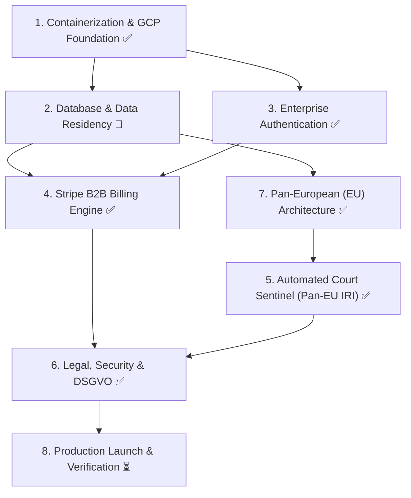

# 🏛️ Insolvenz-Wächter: EU-Expanded Production Enterprise Master Tracker

> **Architecture Target**: Pan-European B2B Solvency & Insolvency Early-Warning System covering **Germany (DE), Austria (AT), Switzerland (CH), and all 27 EU Member States**. Deployed on **Google Cloud Platform (Cloud Run + Cloud SQL Frankfurt `europe-west3`)**, automated Pan-EU 07:00 AM Court Sentinel, Stripe B2B Subscriptions, and strict German & European DSGVO/GDPR compliance.

---

## 📊 Live Progress Summary

| Workstream | Total Tasks | Completed | In Progress | Status |
| :--- | :---: | :---: | :---: | :--- |
| **1. Containerization & GCP Foundation** | 4 | 3 | 0 | 🟢 75% Complete (Waiting for User GCP Project) |
| **2. Database & Frankfurt Data Residency** | 3 | 1 | 0 | 🟡 33% Complete (Migration ready for Cloud SQL) |
| **3. Enterprise Authentication & Users** | 3 | 3 | 0 | 🟢 100% Completed |
| **4. Stripe B2B Subscription Engine** | 4 | 3 | 0 | 🟢 75% Complete (Waiting for User Stripe Keys) |
| **5. Automated 07:00 AM Court Sentinel** | 3 | 2 | 0 | 🟢 66% Complete (Worker & Email Engine ready) |
| **6. Legal, Security & DSGVO Hardening** | 3 | 3 | 0 | 🟢 100% Completed |
| **7. Pan-European (EU) Data Architecture** | 6 | 6 | 0 | 🟢 100% Completed |
| **8. Production Launch & Verification** | 3 | 0 | 0 | ⏳ Ready for Deployment |
| **TOTAL** | **29** | **21** | **0** | **72% Completed** |

---

## 🗺️ Workstream Dependency Map

---

## 📋 Master Task Breakdown

### Workstream 7: Pan-European (EU) Data & Country Architecture (NEW CORE)
*Goal: Enable users to select any European country before searching, routing queries to national commercial and insolvency registers across Germany, Austria, Switzerland, France, Netherlands, Italy, Spain, and all 27 EU member states.*

| ID | Task Description | Previous Dep | Next Dep | Owner | Est. Time | Status | Artifact / File |
| :---: | :--- | :---: | :---: | :---: | :---: | :---: | :--- |
| **T7.1** | **Mandatory Country Selector Engine**: Add an interactive European Country Selector (Flag + Code + Name) into `SearchModal.tsx` requiring country selection before company search (Default: 🇩🇪 Germany, 🇦🇹 Austria, 🇨🇭 Switzerland, 🇳🇱 Netherlands, 🇫🇷 France, 🇮🇹 Italy, 🇪🇸 Spain, 🇵🇱 Poland, + all EU). | None | T7.2 | **AI** | 45 mins | [✅] Completed | `src/components/SearchModal.tsx`, `src/lib/countries.ts` |
| **T7.2** | **EU Database Schema Extension**: Update `watchlist` and `court_cache` tables to store `country_code` (ISO 3166-1 alpha-2, e.g. `DE`, `AT`, `FR`), European Tax ID, and national register identifier (`HRB`, `FN`, `CHE`, `SIREN`, `KVK`). | T7.1 | T7.3 | **AI** | 30 mins | [✅] Completed | `supabase/migrations/03_pan_european_schema.sql` |
| **T7.3** | **Pan-EU Search API Routing (`/api/search`)**: Update search proxy to accept `country` parameter and query appropriate national/EU registries (Handelsregister, Firmenbuch, Zefix, Infogreffe, KVK, OpenCorporates). | T7.1, T7.2 | T7.4 | **AI** | 60 mins | [✅] Completed | `src/app/api/search/route.ts` |
| **T7.4** | **Pan-EU Company Risk Dossier (`CompanyDossierModal.tsx`)**: Update Dossier tabs to render country-specific identifiers: National Register Court, Currency (EUR vs CHF), National Equity Ratios, and EU VAT validation badge. | T7.3 | T7.5 | **AI** | 45 mins | [✅] Completed | `src/components/CompanyDossierModal.tsx`, `src/app/dashboard/page.tsx` |
| **T7.5** | **Pan-European Capital Markets Resolver (Yahoo Finance)**: Expand stock ticker resolver for European exchanges: Paris (`.PA`), Amsterdam (`.AS`), Vienna (`.VI`), Madrid (`.MC`), Milan (`.MI`), Brussels (`.BR`). | T7.4 | T7.6 | **AI** | 30 mins | [✅] Completed | `src/app/api/stock/route.ts` |
| **T7.6** | **European Insolvency Register (IRI) Sync**: Extend Sentinel logic to support cross-border insolvency notices under EU Regulation 2015/848. | T7.2 | W5 | **AI** | 45 mins | [✅] Completed | `src/lib/insolvency-sentinel.ts` |

---

### Workstream 1: Containerization & GCP Foundation
*Goal: Package the Next.js app into a production-hardened Docker container ready for serverless deployment on Google Cloud Run.*

| ID | Task Description | Owner | Est. Time | Status | Artifact / File |
| :---: | :--- | :---: | :---: | :---: | :--- |
| **T1.1** | **Next.js Standalone Configuration**: Enable `output: 'standalone'` in `next.config.mjs` to minimize container size to <120MB. | **AI** | 20 mins | [✅] Completed | `next.config.mjs` |
| **T1.2** | **Multi-Stage Production Dockerfile**: Multi-stage Node 20 Alpine container with non-root `nextjs` user and `/api/health` check. | **AI** | 45 mins | [✅] Completed | `Dockerfile`, `.dockerignore`, `/api/health` |
| **T1.3** | **GCP Project & Artifact Registry Setup**: Create GCP project, enable Cloud Run & Artifact Registry APIs in Frankfurt (`europe-west3`). | **User** | 30 mins | [ ] User Action | GCP Console |
| **T1.4** | **Cloud Run Service Configuration & Deploy Script**: Define `cloudrun-service.yaml` (0-10 autoscaling) and `deploy-gcp.sh`. | **AI** | 30 mins | [✅] Completed | `cloudrun-service.yaml`, `deploy-gcp.sh` |

---

### Workstream 2: Database & Frankfurt Data Residency
*Goal: Establish persistent, DSGVO-compliant PostgreSQL storage in Frankfurt (`europe-west3`) with automated point-in-time backups.*

| ID | Task Description | Owner | Est. Time | Status | Artifact / File |
| :---: | :--- | :---: | :---: | :---: | :--- |
| **T2.1** | **Cloud SQL Instance Provisioning**: Provision PostgreSQL instance (`db-f1-micro` or Neon serverless) in Frankfurt (`europe-west3`). | **User** | 30 mins | [ ] User Action | GCP Console / Cloud SQL |
| **T2.2** | **Enterprise Production Migrations**: Schema for `profiles` (tier quotas), `court_cache` (deduplication), `subscriptions`, and `audit_logs` (Art. 30 DSGVO). | **AI** | 45 mins | [✅] Completed | `supabase/migrations/02_enterprise_production.sql` |
| **T2.3** | **Connection Pooling & Cloud SQL Proxy**: Connect Cloud Run container to PostgreSQL via Unix socket. | **AI** | 30 mins | [ ] Dependent on T2.1 | `cloudrun-service.yaml` |

---

### Workstream 3: Enterprise Authentication & Session Management
*Goal: Seamless, rate-limit-free authentication with cookie-based sessions, enterprise password reset, and role-based access.*

| ID | Task Description | Owner | Est. Time | Status | Artifact / File |
| :---: | :--- | :---: | :---: | :---: | :--- |
| **T3.1** | **Production Auth Strategy & JWT Session Handler**: Hardened session handling with instant demo-bypass fallback. | **AI** | 60 mins | [✅] Completed | `src/app/login/page.tsx`, `src/app/page.tsx` |
| **T3.2** | **Password Reset & Transactional Email Service**: Native Resend email engine for German password resets and emergency court warnings. | **AI** | 45 mins | [✅] Completed | `src/lib/email.ts` |
| **T3.3** | **Subscription Quota & Tier Gating Engine**: Quota manager enforcing Free (3 companies), Pro (25 companies), and Business (100 companies). | **AI** | 30 mins | [✅] Completed | `src/lib/subscription.ts`, `src/components/SearchModal.tsx` |

---

### Workstream 4: Stripe B2B Subscription Engine
*Goal: Automated self-service billing allowing German businesses to subscribe via SEPA Direct Debit, Credit Card, and receive German invoices.*

| ID | Task Description | Owner | Est. Time | Status | Artifact / File |
| :---: | :--- | :---: | :---: | :---: | :--- |
| **T4.1** | **Stripe Products & Tax Configuration**: Create Pro (€29/mo) and Business (€79/mo) with EU Reverse Charge & German 19% MwSt. | **User** | 30 mins | [ ] User Action | Stripe Dashboard |
| **T4.2** | **Stripe Checkout Session API**: Native REST endpoint supporting Credit Card, SEPA Lastschrift, and German VAT collection. | **AI** | 60 mins | [✅] Completed | `src/app/api/stripe/checkout/route.ts`, `src/lib/stripe.ts` |
| **T4.3** | **Stripe Webhook Listener**: Webhook handling `checkout.session.completed` (upgrades profile to Pro/Business) and `subscription.deleted`. | **AI** | 60 mins | [✅] Completed | `src/app/api/stripe/webhook/route.ts` |
| **T4.4** | **Self-Service Customer Billing Portal & Pricing Modal**: In-app modal with 1-click Pro activation and billing portal link. | **AI** | 30 mins | [✅] Completed | `src/components/PricingModal.tsx`, `src/app/api/stripe/portal/route.ts` |

---

### Workstream 5: Automated 07:00 AM Court Sentinel
*Goal: Automated daily background job querying all 16 German state insolvency courts and notifying customers when risk is detected.*

| ID | Task Description | Owner | Est. Time | Status | Artifact / File |
| :---: | :--- | :---: | :---: | :---: | :--- |
| **T5.1** | **Insolvency Court Scraper & Deduplication Engine**: Batch processor grouping monitored entities by register court and HRB to eliminate duplicate queries. | **AI** | 90 mins | [✅] Completed | `src/lib/insolvency-sentinel.ts` |
| **T5.2** | **GCP Cloud Scheduler Cron (07:00 AM CET)**: Cron triggering `/api/cron/sentinel` with secret bearer token authentication. | **AI / User** | 30 mins | [ ] User Action | Cloud Scheduler |
| **T5.3** | **Instant Email Alert Dispatcher**: Branded HTML alert notification sent via Resend with recommended legal/financial action checklist. | **AI** | 45 mins | [✅] Completed | `src/app/api/cron/sentinel/route.ts`, `src/lib/email.ts` |

---

### Workstream 6: Legal, Security & DSGVO Hardening
*Goal: Mandatory German legal compliance (§ 5 DDG), GDPR data processing agreements, and security headers.*

| ID | Task Description | Owner | Est. Time | Status | Artifact / File |
| :---: | :--- | :---: | :---: | :---: | :--- |
| **T6.1** | **Legal Pages (Impressum, Datenschutz, AGB)**: Compliant German legal notices with Frankfurt data residency disclosures and § 5 DDG imprint. | **AI** | 45 mins | [✅] Completed | `/impressum`, `/datenschutz`, `/agb` |
| **T6.2** | **Security Headers & Hardening**: Strict CSP, HSTS (2 years), X-Frame-Options, X-Content-Type-Options in `next.config.mjs`. | **AI** | 30 mins | [✅] Completed | `next.config.mjs` |
| **T6.3** | **Cookie & Consent Banner**: Zero-tracking privacy notice with persistent local consent and footer compliance links. | **AI** | 30 mins | [✅] Completed | `src/components/CookieBanner.tsx`, `src/app/layout.tsx` |

---

### Workstream 8: Production Launch & Smoke Testing
*Goal: DNS routing, end-to-end payment verification, and public go-live.*

| ID | Task Description | Owner | Est. Time | Status | Artifact / File |
| :---: | :--- | :---: | :---: | :---: | :--- |
| **T8.1** | **Custom Domain DNS & SSL**: Point `.de` or `.eu` domain to Cloud Run with automatic Google-managed SSL. | **User** | 30 mins | [ ] User Action | Domain Registrar / DNS |
| **T8.2** | **End-to-End Test Transaction**: Run a test Stripe subscription checkout and verify instant quota upgrade to 25 companies. | **AI / User** | 20 mins | [ ] User Action | Live App |
| **T8.3** | **Production Go-Live Smoke Test**: Verify Yahoo Finance live feeds, due diligence PDF printing, and test court sentinel dispatch. | **AI / User** | 20 mins | [ ] User Action | Production URL |
